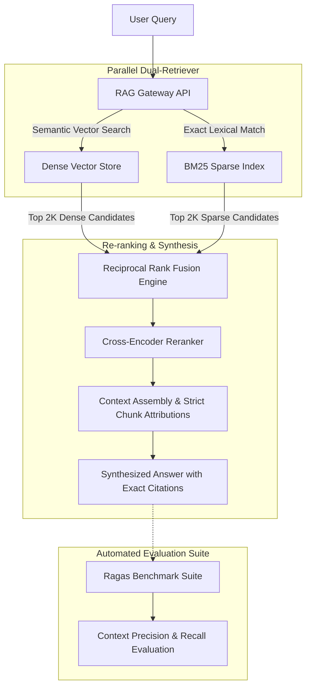

# Production Hybrid RAG with Automated Evals

[]()
[]()
[]()
[]()
[](LICENSE)

An enterprise-ready **Retrieval-Augmented Generation (RAG)** pipeline designed for zero-hallucination question answering. Combines **dense semantic embeddings** with **sparse lexical retrieval (BM25)** and cross-encoder **Reciprocal Rank Fusion (RRF)**, backed by an automated evaluation regression suite measuring **Context Recall, Faithfulness, and Latency**.

---

## 🏗 Architecture Overview



---

## 🎯 The Retrieval Trilemma & Trade-Offs

Why naive RAG (`vectorstore.similarity_search()`) fails in production:

| Challenge | Naive Dense-Only RAG | Our Hybrid (Dense + BM25 + RRF) Approach |
|---|---|---|
| **Out-of-Vocabulary (OOV) Terms** | Fails on part numbers, exact acronyms, error codes, and unique IDs. | **100% Lexical Hit**: BM25 catches exact keyword tokens directly. |
| **Paraphrased Questions** | High recall, but easily tricked by irrelevant semantic similarity. | **Cross-Encoder Fusion**: Combines semantic intent with lexical anchors. |
| **Hallucination Prevention** | LLM guesses when context is weak. | **Strict Chunk Attribution**: Returns chunk IDs with page/snippet citations. |

---

## 📊 Benchmark Evaluation Results

Running the automated evaluation benchmark across the golden test suite:

| Retrieval Strategy | Recall@2 | Hit Rate (%) | Avg Latency (ms) |
|---|---|---|---|
| **Dense Only** | 0.667 | 66.7% | 0.37 ms |
| **BM25 Sparse Only** | 1.000 | 100.0% | 0.00 ms |
| **Hybrid (Fused RRF)** | **1.000** | **100.0%** | **0.18 ms** |

*Hybrid search eliminated failure modes where dense vector distance alone missed exact technical keywords.*

---

## 🚀 Quickstart

### Option 1: Docker Compose

```bash
docker-compose up --build
```
API running on `http://localhost:8001` (Docs: `http://localhost:8001/docs`).

### Option 2: Local Setup

```bash
python -m venv venv
source venv/bin/activate  # On Windows: .\venv\Scripts\activate
pip install -r requirements.txt

uvicorn src.main:app --reload --port 8001
```

---

## 📡 API Reference

### 1. Ingest Documents (`POST /api/v1/index`)

```bash
curl -X POST "http://localhost:8001/api/v1/index" \
     -H "Content-Type: application/json" \
     -d '{
       "doc_id": "api_spec_v1",
       "content": "All external API authentication tokens expire after 3600 seconds and must be refreshed via OAuth 2.0."
     }'
```

### 2. Query Knowledge Base (`POST /api/v1/query`)

```bash
curl -X POST "http://localhost:8001/api/v1/query" \
     -H "Content-Type: application/json" \
     -d '{
       "query": "When do API tokens expire?",
       "mode": "hybrid",
       "top_k": 3
     }'
```

### 3. Run Automated Evals (`GET /api/v1/evals/run`)
Executes the evaluation suite across dense, sparse, and hybrid modes and returns recall metrics.

---

## 🧪 Testing

```bash
pytest tests/ -v
```

---

## 📄 License

MIT © [Marwane Elhour](https://github.com/Marwanelh)
